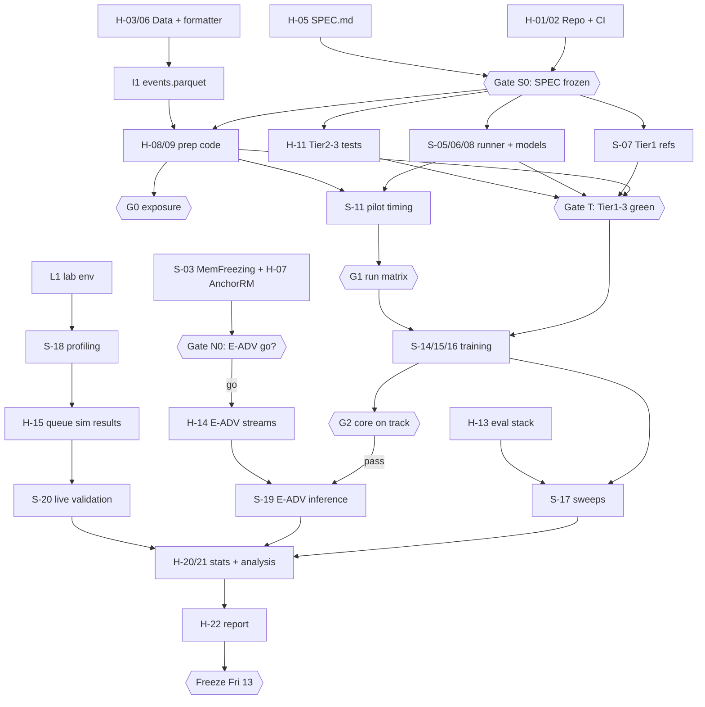
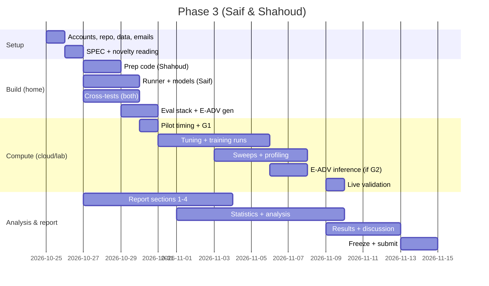

# Phase 3 Execution Roadmap — Streaming AML (Saif & Shahoud)

**Written:** Sunday 25 October 2026 · **Hard deadline:** Sunday 15 November 2026 (Phase 3 brief) · **Target submission:** Saturday 14 November

**How the documents fit together**

| Document | Answers | Status |
|---|---|---|
| `ROADMAP.md` (this file) | **Who** does **what**, **when**, on **which machine**, and how work is handed over | Execution source of truth |
| `PHASE3_PLAN.md` (v3) | **What** we measure and **why**: RQs, hypotheses, E-ADV design, verification tiers, budget | Research design source of truth |
| `cn_phase2.tex` (Revision 2) | The academic design document | Needs one sync after the novelty decision (task H-18) |

If this roadmap and `PHASE3_PLAN.md` disagree on **dates**, this roadmap wins. If they disagree on **methods**, the plan wins.

> **Date assumption:** today is Sunday 25 October 2026. If you start later, shift every home-phase date by the same number of days and re-check the gates in §9.

---

## 1. Executive summary and original objectives

### 1.1 Summary
- **Nothing is implemented yet.** The research design is complete and verified; code, data, environments and accounts are not.
- **All critical-path work can start at home today.** Home machines have no CUDA GPU, so every GPU job runs on **Kaggle, molab or Colab** until the university PC is available.
- **The university PC is needed for only 3 short sessions** (environment + pilot, latency profiling, live validation). Everything else on it is opportunistic. If access never comes, there is a documented fallback (§7.6).
- **Two-person split:**
  - **Saif** leads models, training, cloud GPU runs and lab sessions.
  - **Shahoud** leads data, precomputation, evaluation, the attack generator, and the report.
  - Each person writes the **independent verification tests for the other's code**.
- **Every stage leaves a usable result.**
  - MVP numbers by **Sunday 1 November**.
  - Core results complete by **Sunday 8 November**.
  - Code freeze on **Friday 13 November**.

### 1.2 Original objectives (from project history)
| # | Objective | Source |
|---|---|---|
| O1 | Deliver Phase 3 with all **7 brief components**: (1) implementation with class feedback incorporated and changes documented, (2) dataset and preprocessing, (3) baselines with metrics, (4) graphs, (5) comparison with published results, (6) ablations, (7) discussion | `Phase 03 - Implementation.pdf` |
| O2 | Finish by **15 Nov 2026** | Phase 3 brief |
| O3 | Score highly — the project is **25% of the course grade** | Your message |
| O4 | Produce a strong **portfolio piece** | Your message |
| O5 | Lay the groundwork for **publication at a reputable venue** (realistically a winter extension, not by 15 Nov) | Earlier discussion |
| O6 | Genuine **novelty**: the freshness study plus the adversarial timing study (E-ADV), with no novelty claims made without evidence | Earlier discussion |
| O7 | Respect **2–3 lab-GPU hours/day**, with no overnight or uninterrupted access assumed | Your message |
| O8 | **Exclude the Quadro T1000** entirely | Your message |
| O9 | **No fabrication**: every number traced to a log, every claim to a source | Throughout |
| O10 | Keep **Phase 2 and Phase 3 aligned** | Your message |

### 1.3 Success criteria (15 Nov)
- **S1:** All 7 brief components present in the report, each backed by script-generated tables and figures.
- **S2:** Verification Tiers 1–5 pass (`PHASE3_PLAN.md` §6); the test report is in the appendix.
- **S3:** HI-Small results with 3 seeds and 95% CIs for RQ1–RQ3, plus ≥ 3 ablations.
- **S4:** E-ADV results, **if** both the novelty gate (N0) and Gate G2 pass.
- **S5:** Reproducible repository: one command per table, a data card, and pinned environments.
- **S6:** Both of you can explain every module (viva-ready).

---

## 2. Current progress audit

### 2.1 Completed (verified to exist)
| Artefact | Path | Status |
|---|---|---|
| Phase 1 report | `CN_Assignment_1.pdf` | Submitted |
| Phase 2 Revision 2 source | `cn_phase2.tex`, `references.bib` | Compiles: 74 pages, 0 errors, 0 undefined refs, max overfull 2.6 pt |
| Phase 2 PDF | `i232634_i232515_Extended Literature Review_Phase 2.pdf` | Built 25 Oct |
| Methodology diagram | `methodology_architecture.tex` / `.pdf` | Matches Revision 2 |
| Research plan v3 | `PHASE3_PLAN.md` | RQ1–RQ3, E-ADV, verification tiers, budget |
| Initial novelty check for E-ADV | `PHASE3_PLAN.md` §1 | **Partial**: 3 search queries; MemFreezing not yet read |
| Git repository (docs folder) | this folder | Initialised on `master`, **0 commits** (by your instruction) |

### 2.2 Not started
- **Code:** none. There is no `src/`, no tests and no environment file.
- **Data:** nothing downloaded.
- **Cloud accounts:** Kaggle, Colab and molab GPU access not verified.
- **University PC:** no environment check run; access date unknown.
- **Phase 2 class feedback:** not collected.

### 2.3 Unresolved issues (each has an owner and a deadline in §9)
| # | Issue | Why it matters | Resolved by |
|---|---|---|---|
| U1 | **MemFreezing** not read in full | It decides whether E-ADV is novel | S-03, Mon 26 |
| U2 | **AnchorRM** not read in full | Decides how IBC is framed | H-07, Mon 26 |
| U3 | Phase 2 does not yet contain E-ADV or the verification regime | O10 alignment | H-18, after N0 |
| U4 | ~~MOLAP vs molab~~ **Resolved 25 Oct: you meant molab.** Phase 2 §13.2 and `PHASE3_PLAN.md` §7.3 now evaluate molab | — | Done |
| U5 | University PC access date and conditions unknown | Decides the lab track (§7) | H-04 email, Sun 25 |
| U6 | ~~Machine ownership~~ **Resolved 25 Oct: MacBook = Saif, HP = Shahoud** (§3.1) | — | Done |
| U7 | Phase 3 submission format, page limit, viva? | Report scope | H-04 email |
| U8 | Multi-GNN's formatter may need `datatable`, whose Windows/py3.11 support is uncertain | Data preparation path | H-06 fallback: run it on Kaggle |

---

## 3. Resources, environments and constraints

### 3.1 Hardware
| Machine | Verified specs | Owner | Role in this roadmap |
|---|---|---|---|
| University lab PC (Dell Precision 3680, Windows 11 Enterprise, domain-joined) | RTX 4000 Ada 20 GB (BF16), i7-14700, 32 GB RAM, ~1.7 TB | Shared | **Target hardware for latency.** 3 critical sessions plus opportunistic runs |
| MacBook Pro M1 Pro | 32 GB unified memory, 512 GB; MPS, **no CUDA**; macOS | **Saif** | Model and runner development on CPU (1% subsets; PyG on CPU, not MPS), cloud launches, Tier 1 references, overnight CPU jobs if the HP runs short of RAM; later the Ethereum conversion (winter) |
| HP 15s-fq5xxx | i5-1235U, 20 GB, ~180 GB; **no CUDA**; Windows | **Shahoud** | All HI-Small precomputation, XGBoost, evaluation, queue simulation, report, and the **Windows lab-environment pack** (same OS as the lab PC) |
| Saif's PC with Quadro T1000 | — | Saif | **Excluded (O8)** |

**Memory budget on the HP (20 GB):** HI-Small has 5.08M rows, so the formatted stream and every derived file fit comfortably if steps run one at a time with polars' lazy or streaming mode. If a step does run out of memory, move just that step to Saif's MacBook overnight or to a molab CPU notebook (32 GB), and record where it ran in the data card.

### 3.2 Cloud environments
| Environment | Verified facts | Unknowns to test on day 1 | Role |
|---|---|---|---|
| **Kaggle** | Hosts the IBM AML dataset; GPU notebooks; **"Save & Run All" commits run in the background after the browser is closed**; 12-h sessions; outputs persist | Weekly GPU quota in your accounts (~30 h/week is commonly reported, unofficial); phone verification needed for GPU and internet (check) | **Primary unattended training.** Two accounts, one per person |
| **molab** (marimo) | Free; 4 CPU + 32 GB RAM per notebook; optional **RTX Pro 6000 Blackwell, 96 GB** (public preview); ≤ 12-h sessions; **shut down after > 90 min idle**; limited persistent storage (storage page dated 31 Jul 2026: 1 GB / 15,000 files); **notebooks are public but undiscoverable by default**; torch preinstalled | (a) Does a running cell count as "not idle" with the browser closed? (b) GPU availability at your hours. (c) Upload and load time for our data. (d) What counts as "reasonable usage" | **Potentially the strongest free GPU. Not on the critical path until it passes S-02** |
| **Google Colab (free)** | GPU type not guaranteed (often T4); sessions ≤ 12 h; idle and closed-browser disconnects; limits fluctuate (Colab FAQ) | Availability at your hours | Overflow and interactive GPU debugging only |
| GitHub (free) | Private repositories; Actions minutes for private repos on the free plan | — | Code hosting, CI, task board |

**molab safety rules (because notebooks are public by default):**
- Never paste API keys, Kaggle tokens or passwords into molab notebook code.
- Move code in by uploading `aml-stream.zip` through the sidebar.
- Move data in by uploading through the sidebar, or by rebuilding derived files from the raw CSV at session start.

### 3.3 molab assessment (resolves U4)
**Verdict: worth testing on day 1; promote to primary GPU only if it passes all three acceptance tests in S-02.**

| Criterion | Assessment |
|---|---|
| Compute | Excellent on paper: 96 GB VRAM is far beyond what our models need. Its value is **availability**, not size |
| Unattended runs | **Unknown.** If closing the browser counts as "idle", molab is only usable for attended sessions (like Colab) and the resumable runner is mandatory |
| Storage | Tight. Persist only the raw CSV plus code if within quota; rebuild derived files at session start (≈ minutes, 4 CPUs) |
| Reproducibility | A consistent GPU model, which makes it a **good fallback for latency profiling** if the lab PC is unavailable |
| Risks | Public preview; unpublished quota; policy may change. Never the only copy of anything |

### 3.4 Constraints (verified unless marked)
- Deadline **15 Nov 2026**.
- Lab GPU: **2–3 h/day, no overnight, interruptions possible**.
- No admin rights on the lab PC (**assumed**).
- GFP is **not supported on Windows**.
- Multi-GNN expects **Linux** (`env.yml`: Python 3.9, CUDA 11.8, `torch-sparse`, `datatable`).
- **Effort (assumption):** ~6 focused hours per person per day, including weekends. If lower, use the reduction ladder in `PHASE3_PLAN.md` §10 from Gate G1.

### 3.5 GPU capacity vs requirement
| Source | Planning hours (25 Oct–10 Nov) |
|---|---|
| Kaggle (2 accounts) | 40–60 |
| Lab PC | 0–42 (depends on the access date) |
| molab | Unknown until S-02; treated as 0 for planning |
| Colab | Overflow only; treated as 0 |
| **Requirement** (`PHASE3_PLAN.md` §10) | **37–89** |

**Implication:** with Kaggle only, the low end fits and the high end does not. Gate G1 applies the reduction ladder if molab fails and lab access is late.

---

## 4. Home-PC execution plan

### 4.1 Principles
1. **Everything that depends only on the data is done on CPU, once.** This covers the formatted stream, splits, causal features, neighbour indices, intra-block context (IBC), merged aggregates, exposure ρ and the E-ADV perturbed streams. Outputs are versioned Parquet/NumPy files.
2. **Write the contract first, then the code.** `SPEC.md` freezes file schemas and maths definitions on Monday 26 Oct (Gate S0), so you can build in parallel without waiting on each other.
3. **Cross-verification.** Each person writes the independent reference tests for the other's code, from `SPEC.md` only.
4. **Cloud runs are just runner commands.** The same `run_queue.py` runs on Kaggle, molab, Colab and the lab PC; only the time budget changes.

### 4.2 What gets prepared at home
| Category | Items | Owner |
|---|---|---|
| Tools | Git, GitHub CLI (optional), Miniforge or `uv`, VS Code / Claude Code, Kaggle CLI, LaTeX (already working for Phase 2) | Both |
| Environments | `environment-dev.yml` (CPU, home); `environment-cloud.lock` (exact versions captured on Kaggle); `aml-lab.zip` (conda-pack of a Windows CUDA environment, built on the HP); `wheelhouse/` (offline pip fallback) | Saif (cloud lock), Shahoud (lab pack) |
| Data | `HI-Small_Trans.csv`, `HI-Small_Patterns.txt` (check exact filenames on the Kaggle page), checksums, `formatted_transactions.csv`, `events.parquet`, `DATA_CARD.md` | Shahoud |
| Derived data | `nbr_<gran>.npy`, `ibc_<gran>.parquet`, `feat_causal.parquet`, `merged.parquet`, `exposure.parquet`, `adv_<cond>_<W>.parquet` | Shahoud |
| Code | `src/prep`, `src/eval`, `src/stream`, `src/adv` (Shahoud); `src/models`, `src/train`, `notebooks/` (Saif) | Split |
| Tests | Tier 1 references for prep (Saif); Tier 2–3 model tests (Shahoud); Tier 4 numerical tests (Shahoud); CI (Shahoud) | Cross |
| Docs | `SPEC.md`, `DECISIONS.md` (pre-registration), `RESOURCES.md` (account tests), `lab_setup/README_LAB.md`, report skeleton | Split |

### 4.3 Data acquisition commands (Shahoud, HP, PowerShell)
```powershell
pip install kaggle
# Put kaggle.json (from Kaggle > Settings > API > Create New Token) in $env:USERPROFILE\.kaggle\
cd C:\dev\aml-stream
kaggle datasets download -d ealtman2019/ibm-transactions-for-anti-money-laundering-aml -f HI-Small_Trans.csv -p data\raw
kaggle datasets download -d ealtman2019/ibm-transactions-for-anti-money-laundering-aml -f HI-Small_Patterns.txt -p data\raw
Get-ChildItem data\raw\*.zip | ForEach-Object { Expand-Archive $_ -DestinationPath data\raw -Force }
Get-FileHash data\raw\*.csv, data\raw\*.txt -Algorithm SHA256 | ForEach-Object { "$($_.Hash.ToLower())  $(Split-Path $_.Path -Leaf)" } | Out-File -Encoding utf8 data\checksums.txt
# Same format as sha256sum, so Kaggle, molab and the lab PC can verify with the same file
```
Check the exact filenames on the dataset page before running. The `-f` downloads may arrive zipped or unzipped.

### 4.4 Multi-GNN formatter (verified usage from the repository README)
```powershell
git clone https://github.com/IBM/Multi-GNN.git third_party\Multi-GNN
python third_party\Multi-GNN\format_kaggle_files.py data\raw\HI-Small_Trans.csv
# produces formatted_transactions.csv; record split boundaries in DATA_CARD.md
```
**Fallback (U8):** Multi-GNN's environment lists `datatable`, which may not install on Windows. If the formatter fails on the HP, run the same command in a Kaggle notebook (Linux), save `formatted_transactions.csv` as a private Kaggle dataset, and download it. Allow 1 hour; do not spend longer fixing the Windows install.

---

## 5. Saif's task assignments — models, training, cloud GPU, lab operator

**Machine:** MacBook Pro M1 Pro (macOS). Develop and test on CPU with 1% subsets; install PyG for CPU and do not rely on MPS. All GPU work happens on Kaggle, molab or the lab PC. Estimates assume AI-assisted coding, with your own review.

| ID | Task | Est. | Prereq | Output | Done when | Date |
|---|---|---|---|---|---|---|
| S-01 | Create accounts: Kaggle (phone verification; enable GPU and internet; API token), Colab, molab, GitHub; accept the repo invite | 1 h | — | Working logins | Kaggle GPU notebook starts | Sun 25 |
| S-02 | **Cloud acceptance tests.** molab: (a) GPU attaches and `torch.cuda.is_bf16_supported()`; (b) a 2-h dummy loop survives a **closed browser**; (c) time to load the raw CSV. Kaggle: GPU + internet + `pip install torch_geometric`. Capture `pip freeze` → `environment-cloud.lock` | 2 h + waiting | S-01 | `RESOURCES.md` with pass/fail per test | Every test has a result | Sun 25–Mon 26 |
| S-03 | **Read MemFreezing in full**; re-run the 3 novelty searches (`PHASE3_PLAN.md` §1.4); write findings in `DECISIONS.md` | 3 h | — | Novelty memo | **Gate N0** decided with Shahoud | Mon 26 |
| S-04 | Review and approve `SPEC.md` | 1 h | H-05 | Approved spec | **Gate S0** | Mon 26 |
| S-05 | `src/train/runner.py`: resume, `--time-budget`, atomic checkpoints every ≤ 10 min (model, optimiser, memory, neighbour buffers, RNG, stream position); `run_queue.py`; job CSV format | 5 h | S0 | Runner | Kill/resume works on a synthetic stream on CPU | Tue 27 |
| S-06 | `src/models/tgn.py` edge classifier (PyG `TGNMemory`) reading precomputed neighbour indices; `heads.py`; focal loss | 5 h | S0 | TGN | Trains on a 1% subset on CPU; loss decreases | Tue 27–Wed 28 |
| S-07 | **Tier 1 reference implementations** for Shahoud's prep code (IBC, causal features, neighbours, exposure, merged, delay), written **from `SPEC.md` only, without opening `src/prep`** | 4 h | S0 | `tests/tier1_reference/` | Runs against `src/prep` once that lands | Tue 27–Wed 28 |
| S-08 | `src/models/dmt_gnn.py` with flags `merged`, `shared_direction`, `use_memory`, `use_ibc` | 6 h | S-06 | DMT-GNN | Tier 2 model tests pass; 1% subset trains | Thu 29 |
| S-09 | Cloud entry points: `notebooks/kaggle_train.ipynb`, `notebooks/molab_train.py`, `notebooks/colab_train.ipynb` — each loads code + data and calls `run_queue.py` | 3 h | S-05 | Notebooks | One job runs end-to-end on Kaggle | Fri 30 |
| S-10 | Publish the processed data as a **private Kaggle dataset** (versioned) | 1 h | H-08, H-09 | Dataset v1 | Notebook can attach it | Thu 29 |
| S-11 | **Pilot timing:** 1 epoch each of TGN fine/block and DMT fine/block on Kaggle (+ molab if S-02 passed); kill/resume on cloud; BF16 vs FP32; packing test where possible | 3 h | S-08, S-10 | `results/pilot_timing.csv` | Budget table filled | Fri 30 |
| S-12 | **Gate G1** with Shahoud: fix the run matrix, machines, precision and packing | 1 h | S-11 | `DECISIONS.md` entry | Job CSVs written | Fri 30 |
| S-13 | **Multi-GNN** on Kaggle (own Python 3.9 environment per `env.yml`): `python main.py --data Small_HI --model gin --emlps --reverse_mp --ego --ports`, seed 42; **5-working-day time box** | 1 h active | H-06 | B2 result or "not reproduced" note | Run finished or box expired | Start Thu 29 |
| S-14 | Tuning grids (8 configs each for TGN and DMT-GNN, successive halving) | Queue | G1, **Gate T** | Best configs | Configs frozen in `configs/` | Fri 30–Sat 31 |
| S-15 | Fine-regime runs: TGN, DMT-GNN, B4, A2, A3 × 3 seeds | Queue | S-14 | Checkpoints + scores | All jobs `DONE` | Sat 31–Thu 5 |
| S-16 | Block-regime runs ± IBC (DMT-GNN, TGN) × 3 seeds | Queue | S-14 | Checkpoints + scores | All jobs `DONE` | Mon 2–Wed 4 |
| S-17 | Granularity sweeps (inference only) | Queue | S-15, S-16, H-13 | `scores_<gran>.parquet` | All granularities present | Wed 4–Sat 7 |
| S-18 | **Service-time profiling** for 4 models (lab; fallback §7.6) | 1.5 GPU-h | L1 | `service_times.csv` | Medians + p95 for n = 1…10⁴ | Tue 3–Wed 4 |
| S-19 | **E-ADV inference**: C0–C3 × Δ × W; defences D1/D2 | 3–6 GPU-h | N0 go, G2 pass, H-14 | `adv_scores_*` | All cells present | Fri 6–Sat 7 |
| S-20 | **Live validation run** of the queue simulation (lab) | 0.5 GPU-h | H-15, S-18 | `live_latency.csv` | Compared with simulation | Mon 9 |
| S-21 | Code read-through, docstrings, README reproduction commands for the model/training side | 4 h | — | README sections | You can explain every module | Tue 10–Thu 12 |
| S-22 | Tier 5: regenerate **Shahoud's** headline RQ1 table from raw logs | 1 h | H-20 | Check note | Numbers match | Thu 12 |
| S-23 | Slides / demo (P1) | 4 h | M4 | Slides | Ready | Wed 11 |

---

## 6. Shahoud's task assignments — data, precompute, evaluation, attack generator, report

**Machine:** HP 15s (Windows, 20 GB). Use PowerShell or Git Bash. Run memory-heavy steps one at a time; any step that does not fit moves to Saif's MacBook overnight or to a molab CPU notebook (§3.1). The HP is also the only Windows machine, which is why it builds the lab-environment pack (H-12).

| ID | Task | Est. | Prereq | Output | Done when | Date |
|---|---|---|---|---|---|---|
| H-01 | Create private GitHub repo **`aml-stream` outside OneDrive** (e.g. `C:\dev\aml-stream`, `~/dev/aml-stream`); skeleton (§10.2); `.gitignore`; invite Saif; add `CODEOWNERS` | 0.5 h | — | Repo | Saif can clone | Sun 25 |
| H-02 | CI: GitHub Actions running `pytest -m "not gpu"` on CPU; protect `main` (PR + green CI + 1 review) | 0.5 h | H-01 | `.github/workflows/tests.yml` | CI green on a placeholder test | Sun 25 |
| H-03 | Download the data and compute checksums (§4.3) | 0.5 h | Kaggle token | `data/raw/`, `data/checksums.txt` | Checksums committed | Sun 25 |
| H-04 | **Emails:** instructor (Phase 2 feedback, Phase 3 format/page limit/viva, whether Revision 2 may be attached); lab admin (the §7.1 checklist) | 0.5 h | — | Sent emails | Replies tracked in `DECISIONS.md` | Sun 25 |
| H-05 | **`SPEC.md`**: file schemas (§10.3), unit assignment rule, and exact definitions of IBC, ρ, causal features, merged aggregates, detection delay, the E-ADV conditions and precedence constraint, and score files. Source: Phase 2 Steps 4–8 and `PHASE3_PLAN.md` §5 | 3 h | — | `SPEC.md` | **Gate S0** (Saif approves) | Mon 26 AM |
| H-06 | Multi-GNN formatter → `events.parquet` (I1); **`DATA_CARD.md`**: counts vs FraudGT (515,088 accounts / 5,078,345 transactions), illicit rate, split boundaries, timestamp resolution, typology counts | 3 h | H-03 | I1 + data card | Counts reconciled, or the difference explained | Mon 26 |
| H-07 | **Read AnchorRM in full**; write a 1-page comparison with IBC in `DECISIONS.md` | 1.5 h | — | Memo | Feeds Gate N0 | Mon 26 |
| H-08 | `src/prep`: `units.py`, `split.py`, `causal_features.py` (DuckDB/polars), `neighbours.py` (numba) | 6 h | S0, I1 | Derived files (I2a) | Tier 1 references match | Tue 27 |
| H-09 | `src/prep`: `ibc.py`, `exposure.py`, `merged.py` | 4 h | H-08 | I2b | Tier 1 references match | Wed 28 |
| H-10 | **Gate G0**: exposure ρ by class and typology at Δ = 10 min against the pre-registered thresholds | 1 h | H-09 | `DECISIONS.md` entry | Keep or reduce RQ2 decided | Wed 28 |
| H-11 | **Tier 2–3 tests for Saif's model code** (score-before-update; memory byte-identical within a unit; resume == no-resume harness; shuffled-label collapse; reversed-time degradation), written **from the `SPEC.md` interface only** | 4 h | S0 | `tests/tier2_properties/`, `tests/tier3_sanity/` | Run against Saif's code | Wed 28–Thu 29 |
| H-12 | **Lab environment pack** on the HP (Windows): CUDA PyTorch wheel + PyG + dependencies at the `environment-cloud.lock` versions → `conda pack` → `aml-lab.zip`; also a `wheelhouse/` for two CUDA variants; `lab_setup/*.ps1` scripts (§7.3) | 1 h active + downloads | S-02 lock | `aml-lab.zip`, scripts | Unpacks and imports on the HP (CUDA false is expected) | Tue 27 night–Wed 28 |
| H-13 | `src/stream/replay.py` (granularity sweeps), `src/eval/` (metrics, bootstrap, delay, strata), `watch_eval.py` | 6 h | S0 | Evaluation stack | Tier 4 metric tests vs `sklearn` pass | Thu 29–Fri 30 |
| H-14 | **E-ADV generator**: `src/adv/perturb.py` (C0–C3, W ∈ {1 h, 6 h}, A-full and A-partial), `precedence.py` with tests; generate streams | 4 h | **N0 go**, H-08 | I5 `adv_*.parquet` | Precedence, amounts, counterparties and labels unchanged (tested) | Fri 30 |
| H-15 | `src/stream/queue_sim.py` + **M/M/1 closed-form validation** (Tier 4) | 3 h | — | Simulator | Simulated mean wait within tolerance of theory | Sat 31 |
| H-16 | **B1 XGBoost, continuous mode** (CPU) → first real number | 2 h | H-08 | B1 scores | **MVP number** | Sat 31 |
| H-17 | B1 periodic mode, R ∈ {10 min, 1 h, 24 h} | 2 h | H-16 | B1 periodic scores | Done | Sun 1 |
| H-18 | **Phase 2 sync** (if N0 go): add Step 7d (E-ADV) and verification to Step 12; recompile. (The molab wording was already fixed on 25 Oct.) | 2 h | N0 | Revised PDF | 0 errors, 0 undefined refs | Sun 1 |
| H-19 | **Report skeleton** in `report/` (Phase 2 preamble); write "Changes from Phase 2" (`PHASE3_PLAN.md` §3), Data, and Setup sections | 1 h/day | — | Draft sections | Sections 1–4 drafted | Tue 27 onward |
| H-20 | Continuous evaluation of every run; bootstrap tables; figures 1–5 and 8–11 | Ongoing | Scores | `results/tables`, `results/figures` | Regenerated with `make tables figures` | Nov 1–9 |
| H-21 | Analysis: class-conditional staleness, per typology, strata; E-ADV analysis (H5–H7) | 8 h | H-20 | Analysis notes | Every hypothesis has a verdict | Nov 6–10 |
| H-22 | Report: results, comparison with published numbers, discussion, limitations | 10 h | H-21 | Full draft | All 7 components present | Nov 9–12 |
| H-23 | Tier 5: regenerate **Saif's** headline RQ3 table from raw logs | 1 h | — | Check note | Numbers match | Thu 12 |
| H-24 | Kaggle account 2: launch the notebooks Saif prepares, as scheduled | 15 min/run | S-09 | Runs | — | As queued |

---

## 7. University-PC preparation and execution plan

### 7.1 Ask the lab admin before the first session (H-04)
| Question | Why |
|---|---|
| From which date, which hours, and is booking needed? | Sets the access day (**U-day**) |
| Is `pip`/`conda` internet access allowed? Is there a proxy? | Online vs offline install |
| **Is the user profile or disk wiped at logoff** (Deep Freeze or similar)? Which local path persists? | Persistent environment vs unpack every session |
| Are USB drives allowed? | Offline transfer of the 5–6 GB environment pack |
| Auto-logoff / sleep / screen-lock policy? | Whether runs survive a 2-h session |
| Disk quota on the local drive? | Data (~1–3 GB) and environment (~6 GB) |

### 7.2 What actually needs the lab PC
| Priority | Task | Sessions | Can it move elsewhere? |
|---|---|---|---|
| **L1** | Environment check + pilot timing on the target GPU | 1 | Yes (timing comes from Kaggle/molab anyway) |
| **L2** | **Service-time profiling** for 4 models (S-18) | 1–2 | Yes, to molab (consistent GPU); the report must name the device |
| **L3** | **Live validation** of the queue simulation (S-20) | 1 | Same device as L2 |
| L4 | Block-regime runs, sweeps, E-ADV inference | Opportunistic | Yes (Kaggle/molab) |

**Latest access date for lab-measured latency: Wednesday 4 November.** That leaves room for L1–L3 before the report needs the numbers on Monday 9 November. After that date, run the §7.6 fallback.

### 7.3 Files prepared at home (`aml-stream/lab_setup/`)
| File | Purpose |
|---|---|
| `README_LAB.md` | The printed runbook below |
| `lab_check.ps1` | `nvidia-smi`; Python, torch, CUDA, device name, BF16 and PyG versions |
| `bootstrap_online.ps1` | User-level Miniforge (no admin) + `pip install -r requirements-lab.txt` |
| `bootstrap_offline.ps1` | Unpack `aml-lab.zip` → run `conda-unpack` |
| `run_session.ps1` | Activate the env, check data checksums, `python run_queue.py configs/jobs_lab.csv --time-budget 130m` |
| `end_session.ps1` | Copy new `results/runs/*` (no checkpoints) to the transfer location; print a summary |
| Data bundle | `events.parquet` + derived files + `checksums.txt` (USB or OneDrive) |

Key commands, tested on the HP before U-day:
```powershell
# User-level Miniforge, no admin. Use a path that persists (confirm with the lab admin).
Start-Process -Wait .\Miniforge3-Windows-x86_64.exe -ArgumentList '/S','/InstallationType=JustMe','/RegisterPython=0','/AddToPath=0',"/D=$env:LOCALAPPDATA\miniforge3"

# Offline path: unpack the environment built on the HP
Expand-Archive aml-lab.zip -DestinationPath C:\scratch\aml-lab
C:\scratch\aml-lab\Scripts\conda-unpack.exe

# Check
C:\scratch\aml-lab\python.exe -c "import torch;print(torch.__version__, torch.cuda.is_available(), torch.cuda.get_device_name(0), torch.cuda.is_bf16_supported())"
```

**Credentials on a shared PC:**
- Do **not** store GitHub or Kaggle credentials on the lab PC.
- Bring code as a zip of the tagged commit; move results through your university OneDrive in the browser.
- Sign out at the end of every session.

### 7.4 Session 1 runbook (≈ 150 min)
| Minute | Step | Fallback |
|---|---|---|
| 0–10 | Log in; copy the USB bundle to the persistent local path; run `lab_check.ps1` (driver part) | Read the maximum CUDA version from `nvidia-smi` and pick the matching wheelhouse |
| 10–40 | `bootstrap_offline.ps1` (or `bootstrap_online.ps1` if internet works) | Online fails → offline. Offline fails (driver too old) → the second CUDA-variant wheelhouse |
| 40–50 | `lab_check.ps1` (full); verify data checksums | Note any failure and continue with the data that verifies |
| 50–60 | **Screen-lock survival test:** start a 5-min dummy job, lock the screen, return | If it dies: keep the session unlocked, or use shorter budgets |
| 60–135 | `run_session.ps1` with the pilot timing jobs (TGN and DMT-GNN, fine and block, 1 epoch each; BF16 vs FP32; 1 vs 2 vs 3 concurrent) | The runner checkpoints; anything unfinished resumes next session |
| 135–150 | `end_session.ps1`; copy results; sign out everywhere | — |

### 7.5 Later sessions
- **Every session:**
  1. `run_session.ps1` (job order comes from `configs/jobs_lab.csv`, highest priority first);
  2. leave the time budget at the session length minus 15 min;
  3. finish with `end_session.ps1`.
- **Session agenda by priority:** L2 profiling → L3 live validation → block runs / sweeps / E-ADV inference.

### 7.6 Fallback ladder
| Situation | Action |
|---|---|
| No internet on the lab PC | Offline pack (`aml-lab.zip`) |
| No USB allowed | Download `aml-lab.zip` from OneDrive (split into ≤ 2 GB parts if needed) |
| Profile wiped at logoff | Unpack the pack to local scratch each session (≈ 5–10 min); keep data on USB/OneDrive |
| Driver too old for the packed wheel | Use the second CUDA-variant wheelhouse |
| Session cut mid-run | Runner checkpoint → resume next session (≤ 10 min lost) |
| **No lab access by Wed 4 Nov** | **L2/L3 on molab** (consistent GPU) if S-02 passed, else Kaggle. Record the device, and phrase every latency claim as "on GPU X". The lab is used later only to confirm, if available |
| Lab access ends early | All remaining work is already cloud-portable |

---

## 8. Parallel-work matrix and dependency map

### 8.1 Integration points (contracts frozen at Gate S0)
| ID | Artefact | Producer → consumer | Due |
|---|---|---|---|
| I1 | `events.parquet` (formatted, split-labelled) | Shahoud → Saif | Mon 26 |
| I2a | `nbr_<gran>.npy`, `feat_causal.parquet` | Shahoud → Saif | Tue 27 |
| I2b | `ibc_<gran>.parquet`, `merged.parquet` | Shahoud → Saif | Wed 28 |
| I3 | `scores_<gran>.parquet` per run | Saif → Shahoud | From Sat 31, continuous |
| I4 | `service_times.csv` | Saif → Shahoud | Wed 4 |
| I5 | `adv_<cond>_<W>.parquet` | Shahoud → Saif | Fri 30 |
| I6 | Tables / figures | Shahoud → report | From Sun 1 |

### 8.2 What runs in parallel, and what is strictly sequential
| Strictly sequential (critical path) | Parallel and independent |
|---|---|
| S0 spec → prep code → Tier 1 match → Gate T → full runs → sweeps → statistics → report results | Saif's models/runner ‖ Shahoud's prep/eval |
| N0 novelty → E-ADV generator → (G2) → E-ADV inference | Tier 1 references (Saif) ‖ Tier 2–3 tests (Shahoud) |
| Profiling → queue simulation results | B1 XGBoost (CPU) ‖ GNN training (cloud) |
| | Report sections 1–4 ‖ all experiments |
| | Kaggle account 1 ‖ Kaggle account 2 ‖ lab sessions ‖ laptop evaluation |

### 8.3 Dependency map


### 8.4 Collaboration workflow
- **Repositories:**
  - `aml-stream` (code, tests, Phase 3 report) lives **outside OneDrive**. OneDrive syncing a `.git` folder and large data files causes locks and conflicts.
  - This docs folder stays where it is.
- **Branching:** trunk-based. Short-lived branches `saif/<topic>` and `shahoud/<topic>`; PR into `main`; merge only with **green CI + the other person's review**; squash-merge.
- **Ownership (`CODEOWNERS`):**
  - `src/prep`, `src/eval`, `src/stream`, `src/adv`, `tests/tier2_properties`, `tests/tier3_sanity`, `report/` → Shahoud.
  - `src/models`, `src/train`, `notebooks/`, `tests/tier1_reference` → Saif.
  - `SPEC.md` → **both must approve**.
- **Never in git:** raw/processed data, checkpoints, run folders. Processed data is shared as **versioned private Kaggle datasets**; run folders (without checkpoints) go to a **shared OneDrive folder** `aml-results/runs/`. Small generated tables and figures are committed.
- **Tags:** `v0.1-mvp` (Sun 1), `v0.9-core` (Sun 8), `v1.0-freeze` (Fri 13).
- **Daily 15-min sync** (fixed time, e.g. 22:00): what merged, what's blocked, the next 24 h. Track task IDs on a GitHub Projects board.
- **Run naming:** `{model}-{regime}-s{seed}-{yyyymmdd-hhmm}`, e.g. `dmt-block-ibc-s42-20261102-1410`.

---

## 9. Prioritised roadmap and timeline

### 9.1 Gates
| Gate | Date | Decision | Owner |
|---|---|---|---|
| **S0** Spec freeze | Mon 26 (evening) | Schemas and definitions frozen; changes later need both of you | Both |
| **N0** Novelty | Mon 26 (evening) | E-ADV go / no-go after MemFreezing + AnchorRM | Both |
| **G0** Exposure | Wed 28 | Keep or reduce RQ2 (pre-registered thresholds) | Shahoud |
| **T** Tests | Thu 29 (evening) | Tier 1–3 green → full runs allowed | Both |
| **G1** Run matrix | Fri 30 | Measured times → seeds, machines, precision, packing, reductions | Both |
| **MVP** | Sun 1 Nov | B1 + TGN (1 seed) at finest and Δ = 10 min evaluated; tag `v0.1-mvp` | Both |
| **G2** Core on track | Thu 5 Nov | ≥ 80% of core runs evaluated → E-ADV runs; else skip | Both |
| **M4** Core complete | Sun 8 Nov | All core runs and sweeps evaluated; tag `v0.9-core` | Both |
| **Freeze** | Fri 13 Nov | Code tag `v1.0-freeze`; report v2 | Both |

### 9.2 Day-by-day
| Date | Saif | Shahoud | Gate |
|---|---|---|---|
| **Sun 25** | S-01 accounts; S-02 starts (molab/Kaggle tests) | H-01 repo, H-02 CI, H-03 data, H-04 emails | — |
| **Mon 26** | S-02 finish (closed-browser test); S-03 MemFreezing + searches; S-04 spec review | H-05 SPEC.md (AM); H-06 formatter + data card; H-07 AnchorRM | **S0, N0** |
| **Tue 27** | S-05 runner + queue; S-07 Tier 1 refs (start) | H-08 prep core; H-12 lab pack downloads (night); H-19 report 1 h | — |
| **Wed 28** | S-06 TGN; S-07 finish | H-09 IBC/exposure/merged; **H-10 G0**; H-11 tests (start) | **G0** |
| **Thu 29** | S-08 DMT-GNN; S-10 Kaggle dataset; S-13 Multi-GNN launch | H-11 tests finish; H-13 eval stack (start) | **T** |
| **Fri 30** | S-09 notebooks; S-11 pilot timing; **S-12 G1** | H-13 finish; H-14 E-ADV generator (if N0 go) | **G1** |
| **Sat 31** | S-14 tuning grids (Kaggle 1); start S-15 | H-15 queue sim + M/M/1; H-16 B1 continuous; H-24 Kaggle 2 | — |
| **Sun 1 Nov** | S-15 fine runs (TGN ×3) | H-17 B1 periodic; H-18 Phase 2 sync; MVP evaluation | **MVP** |
| **Mon 2** | S-15 DMT-GNN seeds; S-16 block runs (lab/molab) | H-20 auto-evaluation; figures v0 | — |
| **Tue 3** | S-16; S-18 profiling (lab if open) | H-20; H-19 report | — |
| **Wed 4** | S-16 finish; S-17 sweeps; S-18 finish | First RQ1 staleness curves | Lab-latency cutoff |
| **Thu 5** | S-15 A2/A3; S-17 | Bootstrap tables v1 | **G2** |
| **Fri 6** | S-19 E-ADV inference (if G2 + N0) | H-21 analysis (RQ1/RQ2) | — |
| **Sat 7** | S-19 defences D1/D2 | H-21 E-ADV analysis | — |
| **Sun 8** | Reruns only | Statistics complete | **M4** |
| **Mon 9** | S-20 live validation (lab/fallback) | H-22 report results | — |
| **Tue 10** | S-21 read-through + README | H-22 discussion, comparison table | — |
| **Wed 11** | S-23 slides / demo | H-22 full draft | — |
| **Thu 12** | S-22 Tier 5 check | H-23 Tier 5 check; final figures | — |
| **Fri 13** | Freeze | Freeze; report v2 | **Freeze** |
| **Sat 14** | Proofread | Proofread; **submit** | — |
| Sun 15 | Buffer | Buffer | Deadline |

### 9.3 Gantt view


---

## 10. Technical architecture, integration and workflow

### 10.1 Design rules that make the work scale without rewrites
1. **Datasets plug in through `configs/data/*.yaml`.** HI-Small now; LI-Small, HI-Medium and Ethereum later use the same schema.
2. **Models plug in through a registry** (`src/models/__init__.py`: `MODELS = {"tgn":…, "dmt":…}`). B4, A2, A3 and A7 are **flags**, not new files.
3. **Granularity is a single function** (`src/common/units.py`). New update units need no model changes.
4. **One runner everywhere.** Platform differences live only in `--time-budget` and paths.
5. **The GPU writes scores; the CPU computes everything else.** New metrics never need GPU reruns.

### 10.2 Repository layout (`aml-stream/`)
```
SPEC.md  DECISIONS.md  RESOURCES.md  README.md  CODEOWNERS
configs/{data,model,jobs}/        jobs_lab.csv, jobs_kaggle.csv
data/{raw,processed}/ (ignored)   checksums.txt, DATA_CARD.md
src/common/   units.py, io.py, schema.py, seed.py
src/prep/     split.py, causal_features.py, neighbours.py, ibc.py, exposure.py, merged.py
src/adv/      perturb.py, precedence.py, attack_metrics.py
src/models/   __init__.py (registry), tgn.py, dmt_gnn.py, heads.py, losses.py
src/train/    runner.py, run_queue.py, train_loop.py, early_stop.py
src/stream/   replay.py, profile_service.py, queue_sim.py, live_validate.py, jitter.py
src/eval/     metrics.py, delay.py, bootstrap.py, strata.py, watch_eval.py, make_tables.py, make_figures.py
notebooks/    kaggle_train.ipynb, molab_train.py, colab_train.ipynb
lab_setup/    README_LAB.md, *.ps1, requirements-lab.txt
tests/        fixtures/make_stream.py, tier1_reference/, tier2_properties/, tier3_sanity/, tier4_numerical/
results/      tables/, figures/ (committed); runs/ (ignored, synced to OneDrive)
report/       Phase 3 LaTeX (Phase 2 preamble), generated tables included via \input
```

### 10.3 Contracts (frozen in `SPEC.md` at Gate S0)
| File | Key columns / shape | Notes |
|---|---|---|
| `events.parquet` | `event_id:int64, t:int64 (s), src:int32, dst:int32, amt_paid, amt_recv:float32, cur_paid, cur_recv, fmt:int8, label:int8, split:int8, pattern_id:int32 (-1 = none), typology:int8` | Sorted by `t`, then `event_id` |
| `nbr_<gran>.npy` | `int32 [N, S_in+S_out]`, `-1` = padding | Only events from **earlier units** |
| `ibc_<gran>.parquet` | `event_id` + 17 float32 columns | Zero at the finest unit (tested) |
| `scores_<gran>.parquet` | `event_id, unit_id, score:float32` | One per run × granularity |
| Run folder | `config.yaml, git_hash.txt, device.txt, data_version.txt, train_log.csv, scores_*.parquet` | Required for provenance |

### 10.4 Example job and config
```csv
# configs/jobs_kaggle.csv
job_id,config,seed,priority,status
tgn-fine-s42,configs/model/tgn_fine.yaml,42,1,TODO
dmt-fine-s42,configs/model/dmt_fine.yaml,42,1,TODO
```
```yaml
# configs/model/dmt_block_ibc.yaml
model: dmt
regime: {type: block, delta_min: 10}
flags: {merged: false, shared_direction: false, use_memory: true, use_ibc: true}
hidden: 128; heads: 2; S_in: 10; S_out: 10
optim: {lr: 1.0e-3, epochs_max: 10, patience: 2}
loss: {type: focal, alpha: 0.75, gamma: 2}
data: {config: configs/data/hi_small.yaml, version: kaggle-v1}
```

### 10.5 CI (`.github/workflows/tests.yml`)
```yaml
name: tests
on: [push, pull_request]
jobs:
  test:
    runs-on: ubuntu-latest
    steps:
      - uses: actions/checkout@v4
      - uses: actions/setup-python@v5
        with: {python-version: "3.11"}
      - run: pip install torch --index-url https://download.pytorch.org/whl/cpu
      - run: pip install -r requirements-ci.txt
      - run: pytest -m "not gpu" -q
```

---

## 11. Testing, validation and quality assurance

The full definitions are in `PHASE3_PLAN.md` §6. This section covers ownership and timing.

| Tier | What | Written by | Runs where | Must pass by |
|---|---|---|---|---|
| 1 | Brute-force references vs fast prep code (IBC, features, neighbours, exposure, merged, delay) on ≥ 100 random small streams | **Saif** (independence from Shahoud's code) | CI | Gate T (Thu 29) |
| 2 | Invariants: strict `t_e < t`; equal timestamps isolated; memory unchanged within a unit; IBC zero at the finest unit; one merged edge per pair and direction; split order; resume == no-resume; E-ADV changes only timestamps | **Shahoud** for model invariants; Saif for E-ADV invariants | CI (+ a GPU smoke run) | Gate T |
| 3 | Shuffled labels collapse; reversed time degrades; memory off + S = 0 ≈ features only | Shahoud | Cloud (small) | Before S-15 |
| 4 | Metrics vs `sklearn`; queue simulation vs M/M/1; bootstrap coverage on synthetic data | Shahoud | CI | Sat 31 |
| 5 | No hand-typed numbers; cross-regeneration of headline tables | Both (S-22, H-23) | Laptops | Thu 12 |

**Review checkpoints:**
- Every PR is reviewed by the other person.
- **Pair-review** (30 min, screen share) for `neighbours.py`, `ibc.py`, `runner.py`, `train_loop.py` (score-before-update) and `perturb.py`.

**Test fixture:** `tests/fixtures/make_stream.py` generates small synthetic streams with planted patterns and known answers. All tiers use it, so tests never need the real data.

---

## 12. Risks, blockers and contingencies

| Risk | Trigger | Contingency | Recovery |
|---|---|---|---|
| E-ADV not novel | N0: MemFreezing or another paper covers timing-only evasion | Drop E-ADV; RQ1 measurement study remains | Skip H-14, S-19 and H-18's E-ADV part; ~10 GPU-h freed for seeds |
| Lab access late or never | No access by Wed 4 Nov | §7.6: profiling on molab/Kaggle, device stated | None needed for the brief |
| Lab environment fails | Online and offline install both fail | Second CUDA wheelhouse; else treat the lab as unavailable | As above |
| molab unusable unattended | S-02(b) fails | Use molab only for attended sessions; Kaggle stays primary | — |
| Kaggle quota lower than assumed | < 20 h/week shown | Reduction ladder at G1; Colab/molab attended runs | Cut A2 → Multi-GNN → E-ADV breadth |
| Multi-GNN won't run | 5-day box expires | Report published numbers as "not reproduced" | — |
| Formatter dependency fails (U8) | Import error | Run the formatter on Kaggle | 1 h |
| Leakage bug | Tier 2/3 failure, or a shuffled-label run scores well | Stop runs; fix; rerun affected jobs only (runs are keyed by data version) | Budget 1 lost day |
| One person blocked | A dependency is late > 1 day | The blocked person moves to their next parallel task (§8.2); the producer ships a minimal version that meets the contract | Daily sync catches it |
| Merge conflicts | Shared files edited | `CODEOWNERS`, small PRs, `SPEC.md` changes only by agreement | — |
| HP runs out of memory on a precompute step | Out-of-memory error or heavy swapping | Run that step with polars streaming; else move it to Saif's MacBook overnight or a molab CPU notebook | Record where each file was built in the data card |
| Cross-OS differences (macOS dev, Windows HP and lab, Linux cloud) | A test passes on one OS and fails on another | CI on Linux is the referee; use `pathlib` everywhere; pin versions from `environment-cloud.lock` | Fix in CI before merge |
| Secrets leaked via a public molab notebook | — | Never put tokens in notebooks; rotate any token immediately if exposed | — |
| Report crunch | Draft behind on Wed 11 | Sections 1–4 already written since Tue 27; tables auto-generated | Cut slides/demo |
| Can't explain the code in a viva | — | S-21 read-through; `DECISIONS.md` as the narrative | — |

---

## 13. Scalability and progressive enhancement

### 13.1 Stages (each one is a usable result)
| Stage | Contents | Brief components covered | Target |
|---|---|---|---|
| **0 — MVP** | B1 XGBoost + TGN (1 seed) on HI-Small; finest vs Δ = 10 min; published comparison table | 2, 3, 4, 5 (partial) | Sun 1 Nov |
| **1 — Core** | + DMT-GNN, B4, IBC, block regime, 3 seeds; ablations A1/A3/A7 (+A2); full granularity sweep; profiling + queue simulation; detection delay | All 7 | Sun 8 Nov |
| **2 — Differentiator** | E-ADV (C0–C3, D1/D2) | Strengthens 6 and 7 | Sat 7 Nov (if N0 + G2) |
| **3 — Polish** | Multi-GNN 2nd seed; LiveAML demo; slides; live validation | Presentation | Wed 11 Nov |
| **4 — Winter (publication path)** | LI-Small and HI-Medium; seeds 3 → 5; FraudGT under the streaming protocol; a third model family; ρ as a predictor; Ethereum window | Paper | After 15 Nov |

### 13.2 Upgrade triggers (decide with data, not hope)
| Upgrade | Do it only if |
|---|---|
| Use molab as the primary GPU | S-02 (a)–(c) all pass |
| BF16 autocast | Pilot shows ≥ 1.2× throughput with identical validation PR-AUC (± noise) |
| Run packing | Aggregate events/s ≥ 1.3× a single run |
| Add LI-Small during Phase 3 | M4 reached by Sat 7 **and** E-ADV finished or dropped |
| Seeds 4–5 for headline comparisons | GPU hours left after M4 **and** the report draft is on schedule |
| Hyperparameter search beyond the grid | Never in Phase 3 |

### 13.3 Deliberately not doing (avoids premature complexity)
- `torch.compile` / CUDA graphs.
- Multi-GPU training.
- An OLAP cube server (causal aggregates are plain Parquet files).
- A feature store.
- Kubernetes or Docker for the lab.
- Re-implementing FraudGT.
- The Ethereum dataset before winter.

---

## 14. Milestones, deliverables and success criteria

| Milestone | Date | Deliverables | Completion criteria |
|---|---|---|---|
| M0 Setup | Mon 26 | Repo, CI, accounts, data, data card, SPEC, novelty memo | S0 + N0 recorded in `DECISIONS.md` |
| M1 Build | Thu 29 | Prep, models, runner, evaluation stack, all tests | **Gate T** green in CI |
| M2 Pilot | Fri 30 | Timing table, run matrix | **G1** recorded |
| M3 MVP | Sun 1 | B1 + TGN results, published comparison table v0 | `v0.1-mvp` tag; numbers produced by `make tables` |
| M4 Core | Sun 8 | All core runs, sweeps, profiling, queue simulation, E-ADV (if gated) | `v0.9-core`; every hypothesis H1–H7 has a verdict |
| M5 Validation | Mon 9 | Live latency vs simulation | Discrepancy reported |
| M6 Report | Thu 12 | Full report with all 7 components; README; test appendix | Tier 5 checks pass |
| M7 Submission | Sat 14 | Report PDF, repository tag `v1.0-freeze`, slides (P1) | Submitted before Sun 15 |

**Essential (P0):** M0–M4 core, M6, M7 · **Desirable (P1):** E-ADV, live validation, Multi-GNN 2nd seed, slides · **Optional (P2):** demo, LI-Small in Phase 3, seeds 4–5.

---

## 15. Immediate next actions (exact order)

**Today, Sunday 25 October**

| # | Who | Action | Command / detail | Done when |
|---|---|---|---|---|
| 1 | Both | ~~Confirm U4 and U6~~ **Done 25 Oct** (molab; MacBook = Saif). Copy both answers into `DECISIONS.md` when it is created (item 8) | — | Recorded |
| 2 | Shahoud | Create `aml-stream` (private) outside OneDrive; invite Saif | `mkdir C:\dev; cd C:\dev; git clone <repo-url>` | Saif has access |
| 3 | Shahoud | Add skeleton dirs (§10.2), `.gitignore` (`data/`, `results/runs/`, `*.ckpt`), CI file (§10.5), a placeholder test | Commit on a branch → PR → merge | CI green |
| 4 | Saif | Kaggle phone verification; enable GPU and internet; download `kaggle.json`; Colab + molab sign-in | — | All logins work |
| 5 | Shahoud | Kaggle token → download HI-Small + patterns; checksums | §4.3 | `checksums.txt` committed |
| 6 | Shahoud | Send instructor + lab-admin emails (§7.1 questions) | — | Sent |
| 7 | Saif | molab test (a): attach GPU, `torch.cuda.is_available()`, BF16. **Start test (b):** a 2-h loop that prints a timestamp every minute; close the browser; check tomorrow | — | Results in `RESOURCES.md` |
| 8 | Both | Create `DECISIONS.md` and copy the pre-registered thresholds from `PHASE3_PLAN.md` §4.2 **verbatim**, dated today | — | Committed before any data analysis |

**Monday 26 October**

| # | Who | Action | Done when |
|---|---|---|---|
| 9 | Shahoud | Draft `SPEC.md` (§10.3 + definitions) by 13:00 | PR open |
| 10 | Saif | Read MemFreezing in full; run the 3 searches from `PHASE3_PLAN.md` §1.4 | Memo in `DECISIONS.md` |
| 11 | Shahoud | Run the Multi-GNN formatter → `events.parquet` → `DATA_CARD.md` | Counts reconciled with FraudGT Table 1 |
| 12 | Shahoud | Read AnchorRM in full; write the IBC comparison memo | Memo in `DECISIONS.md` |
| 13 | Saif | Review `SPEC.md`; check molab test (b); capture `environment-cloud.lock` on Kaggle | SPEC approved |
| 14 | Both | **Evening sync:** record Gate **S0** (SPEC frozen) and Gate **N0** (E-ADV go/no-go) | Both entries in `DECISIONS.md` |

From Tuesday 27 October, follow §9.2 day by day.
